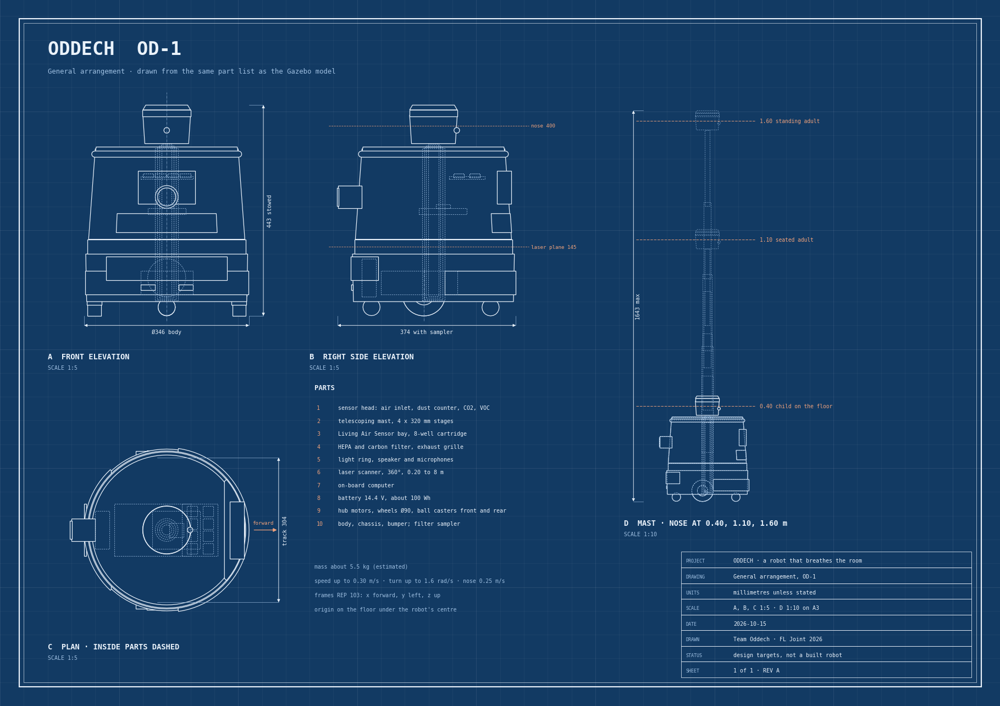

# Oddech OD-1 · Gazebo and ROS 2 package

Oddech is a small indoor robot that "breathes" a room: it drives to where people sit or play, lifts an air inlet (the
"nose") to their breathing height on a telescoping mast, and reads the air with a dust counter and a cartridge of living
airway cells. This folder holds the robot's 3D model and a simulation of it in **Gazebo Harmonic**, with or without
**ROS 2 Jazzy**, plus the model flat from the Oddech website.

Everything here is a **design target for a robot not yet built**: dimensions follow the website's design, masses and
inertias are estimates. Team Oddech · FL Joint Programme 2026 · contact: Julian Evan Chrisnanto, s254167v@st.go.tuat.ac.jp



## What is in the folder

```
oddech_description/          ROS 2 package: the robot
  urdf/oddech.urdf.xacro     robot description (includes oddech.gazebo.xacro: friction, lidar, IMU, plugins)
  urdf/oddech.urdf           the same, expanded, for tools without xacro
  meshes/visual/*.dae        coloured COLLADA meshes, one per link (metres, Z up)
  meshes/stl/*.stl           the same geometry as binary STL
  meshes/parts/*.stl         all 42 parts one by one, the inside parts too (CAD, 3D printing)
  launch/display.launch.py   RViz with joint sliders, no Gazebo
oddech_gazebo/               ROS 2 package: the simulation
  models/oddech/             the robot as a self-contained SDF model (works without ROS)
  models/oddech_flat/        the 8 x 6 m flat: kitchen, cooktop, dining table, play mat, sofa, bookshelf, purifier, dock
  worlds/oddech_flat.sdf     the flat without a robot (ROS spawns it)
  worlds/oddech_demo.sdf     the flat with the robot; keyboard driving
  worlds/oddech_patrol.sdf   the flat with the robot and a timed sampling round
  launch/sim.launch.py       Gazebo + robot from the URDF + robot_state_publisher + topic bridge
  config/ros_gz_bridge.yaml  the topics bridged between ROS 2 and Gazebo
docs/                        the blueprint drawing (SVG, PDF, PNG) and a recorded Gazebo run (gazebo_run.json)
tools/build_model.py         generates every model file above from one part list
tools/check_model.py         checks the generated files
tools/gz_log_to_replay.py    turns a recorded Gazebo run into the website's replay
blueprint.json               parts, joints and dimensions for the website
```

## Run it in Gazebo, without ROS

Needs Gazebo Harmonic (`gz sim`, version 8). From this folder:

```bash
export GZ_SIM_RESOURCE_PATH=$PWD/oddech_gazebo/models
gz sim oddech_gazebo/worlds/oddech_demo.sdf
```

Press play. To drive with the keyboard, open the **Key Publisher** plugin (top-right menu of the Gazebo window), click
the 3D view, then: arrows drive, space stops, **1 2 3** lift the nose to 0.40, 1.10 and 1.60 m.

The sampling round: the robot drives to three spots (by the child's play mat, by the dining table, by the cooktop) and
lifts its nose at each, every step timed in simulation time (about 80 s):

```bash
gz sim -r oddech_gazebo/worlds/oddech_patrol.sdf
gz topic -t /patrol/start -m gz.msgs.Empty -p " "
```

Commands from a terminal:

```bash
gz topic -t /cmd_vel -m gz.msgs.Twist -p "linear: {x: 0.2}, angular: {z: 0.0}"
gz topic -t /mast/cmd -m gz.msgs.Double -p "data: 0.175"       # each stage out 0.175 m: nose at 0.40 + 4 x 0.175 = 1.10 m
gz topic -e -t /odom
```

## Run it with ROS 2 Jazzy

```bash
mkdir -p ~/oddech_ws/src && cp -r <this folder> ~/oddech_ws/src/oddech
cd ~/oddech_ws
rosdep install --from-paths src --ignore-src -y
colcon build --symlink-install && source install/setup.bash

ros2 launch oddech_gazebo sim.launch.py                         # Gazebo, the robot, the bridge
ros2 run teleop_twist_keyboard teleop_twist_keyboard            # drive (another terminal)
ros2 topic pub --once /mast/cmd std_msgs/msg/Float64 "{data: 0.3}"   # nose to 1.60 m
ros2 launch oddech_description display.launch.py                # RViz only, with joint sliders
```

`sim.launch.py` takes `world:=`, `x:=`, `y:=`, `yaw:=` (default: the website's start, 6.6, 3.0, facing -x).

## The robot

| | |
|---|---|
| Body | Ø 346 mm, 443 mm high with the mast stowed |
| Drive | two hub motors, wheels Ø 90 mm, track 304 mm; ball casters front and rear; up to 0.30 m/s and 1.6 rad/s |
| Mast | four nested stages, 320 mm each, each travels 300 mm: nose from 0.40 to 1.60 m at 0.25 m/s |
| Sensors in the model | 2D laser scanner (360 samples, 0.20 to 8 m, 10 Hz) at 145 mm; IMU. No camera, by design |
| Mass | about 5.5 kg (estimate) |

Frames follow REP 103 (x forward, y left, z up). `base_footprint` is on the floor under the robot's centre; `head_link`
is the nose, the height the air is sampled at; `cartridge_link` is the living-cell cartridge; `lidar_link`, `imu_link`.

| Joint | Type | Notes |
|---|---|---|
| `wheel_left_joint`, `wheel_right_joint` | continuous | driven by the DiffDrive plugin |
| `mast_joint_1` to `mast_joint_4` | prismatic, 0 to 0.30 m | all four follow `/mast/cmd` (one value: each stage's extension) |

| Topic | Type | Direction |
|---|---|---|
| `/cmd_vel` | Twist | in: drive |
| `/mast/cmd` | Double (ROS: Float64) | in: extension per stage, nose height = 0.40 + 4 x value |
| `/odom`, `/tf` | Odometry, Pose_V (ROS: TFMessage) | out: odom to base_footprint |
| `/joint_states` | Model (ROS: JointState) | out: wheels and mast |
| `/scan` | LaserScan | out |
| `/imu` | IMU | out |
| `/patrol/start` | Empty | in: starts the sampling round in `oddech_patrol.sdf` |

## Changing the model

All model files are generated from the part list in `tools/build_model.py` (dimensions, colours, masses, joints,
plugin settings). Change it there, then:

```bash
python tools/build_model.py      # needs numpy and matplotlib
python tools/check_model.py      # closed meshes, one URDF tree, valid inertias, URDF and SDF agree, all files present
```

Collisions use simple shapes (cylinders and spheres), the visuals use the meshes.

## What has been tested

On 15 October 2026, with Gazebo Harmonic 8.10 and SDFormat 14.8 (conda-forge, Windows 11), headless:

- `gz sdf -k`: the robot model, the flat and the URDF are valid.
- The demo world loads; the robot stands level on its wheels and front caster.
- Driving: a 0.2 m/s command gives 0.200 m/s in `/odom`, straight; 0.8 rad/s turns in place; wheel speed 4.44 rad/s.
- Mast: all four stages reach 0.300 m (nose at 1.60 m) in about 5 s and settle back to 0.175 m (1.10 m) on command.
- The sampling round ran 82 s of simulated time and never came closer than 0.26 m to furniture, walls or people.

Not tested here: the laser scanner (on this Windows machine Gazebo's GPU rendering would not start headless; it is a
standard `gpu_lidar` sensor), and the ROS 2 launch files (no ROS on the test machine).

## Notes

- Headless machines: the laser scanner needs rendering. On Linux without a display use `gz sim -s --headless-rendering`;
  or remove the `gz-sim-sensors-system` plugin from the world to run physics only.
- Windows: if your user name or folders contain spaces, the `gz` command can fail to start; set `GZ_PARTITION` to a
  name without spaces (e.g. `oddech`) for the topics to work.
- The mast is controlled by position PID on force (p 600, i 60, d 80 per stage), which holds the stages and the head
  against gravity.
- The air itself (PM2.5 and the living-cell response) is not simulated in Gazebo. The Oddech website runs that model
  (room air flow, the robot's map and choices); bringing it into Gazebo as a plugin is a next step.
